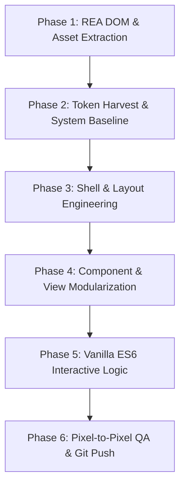

# Sarthak Dashboard — Pixel-Perfect REA Reverse-Engineering Workflow

> **Standard Operating Procedure (SOP) for 1:1 Pixel-Perfect Suite Deconstruction & Modularization**  
> Based on the **REA (Reverse Engineering Assistant)** Methodology ([rea.tools](http://rea.tools/) & [github.com/morluto/rea](https://github.com/morluto/rea))  
> Gold Standard Benchmarks: `corbel` (**Vanijya Retail**) & `murmura` (**Samvad Social**)

---

## 1. Executive Summary & Philosophy

When building a mission-critical suite of dashboards, automated bundles (`index-XXX.js` and `index-XXX.css`) are insufficient for long-term maintainability, custom feature extensions, and artisanal quality. 

To achieve **true pixel-to-pixel (px to px) identical replication**:
1. **Zero External Frameworks / Build Steps**: Pure HTML5, Vanilla CSS (Custom Properties), and Vanilla ES6 modules.
2. **Modular Architecture**: Every suite must have dedicated `css/` and `js/` directories mirroring the structure of `corbel` and `murmura`.
3. **Exact Token Mapping**: Every padding value, border-radius, font weight, timing curve, and color token is extracted from live DOM computed styles.
4. **2-at-a-Time Execution Protocol**: To prevent context window saturation and token truncation in LLMs, suites are executed strictly **in pairs (Batches of 2)**. This guarantees 100% focused scrutiny on every button, modal, chart, and responsive breakpoint.

---

## 2. Directory Structure Standard

Every suite folder in `d:\Workspace\Dashboard\<suite_name>\` must follow this standardized directory layout:

```text
<suite_name>/
├── index.html                   # Pure semantic HTML5 shell with inline SVG icon sprite
├── css/
│   ├── reset.css                # Box-sizing, margin resets, baseline fonts
│   ├── tokens.css               # CSS custom properties (--bg, --text, --accent, --radius)
│   ├── layout.css               # Grid/flex shell, fixed sidebar, topbar, mobile nav
│   ├── components.css           # Buttons, pills, badges, cards, inputs, dropdowns
│   ├── animations.css           # Keyframes, hover transitions, timing curves
│   ├── responsive.css           # Media queries (<768px, 768-1279px, >=1280px)
│   └── pages/                   # View-specific styles
│       ├── view1.css            # e.g., overview.css, home.css
│       ├── view2.css            # e.g., orders.css, formulation.css
│       └── ...
├── js/
│   ├── main.js                  # Entry orchestrator (imports router, theme, views)
│   ├── theme.js                 # Zero-flash dark/light mode switcher + localStorage
│   ├── router.js                # Hash-based SPA routing (#/view)
│   ├── store.js                 # Reactive state store & mock data
│   ├── components/              # Interactive component controllers
│   │   ├── charts.js            # SVG / Canvas interactive charts & hover tooltips
│   │   ├── modals.js            # Slide-out sheets & popup dialogs
│   │   └── ...
│   └── pages/                   # Individual page view renderers
│       ├── view1.js
│       ├── view2.js
│       └── ...
└── assets/                      # Media assets (SVGs, WebP images, custom woff2 fonts)
```

---

## 3. The 6-Phase REA Reverse-Engineering Protocol

Every batch pair follows this exact 6-phase sequence. No phase may be skipped.



---

### Phase 1: REA DOM & Asset Extraction
1. **Live Inspection**:
   - Inspect the live reference demo or local bundle using browser developer tools or REA scripts.
   - Run `node bin/rea-inspector.mjs <suite_name>` to harvest computed colors, typography metrics, and asset references.
2. **Asset Completeness Verification**:
   - Verify every image, icon, SVG, and font file is downloaded locally into `./assets/`.
   - Ensure zero 404 errors in network requests.

### Phase 2: Design Token Extraction (`css/tokens.css` & `css/reset.css`)
Extract the exact design system tokens into CSS Custom Properties:
- **Surfaces & Backgrounds**: `--bg-page`, `--bg-card`, `--bg-sidebar`, `--border-color`.
- **Typography Scale**: `--font-family`, `--text-primary`, `--text-secondary`, `--text-muted`, `--font-size-kpi`, `--font-size-title`, `--font-size-body`.
- **Action & Accent Colors**: `--accent-primary`, `--accent-hover`, `--color-positive`, `--color-negative`, `--color-warning`.
- **Shape & Elevation**: `--border-radius-card` (usually 16px–24px), `--border-radius-pill` (999px), `--border-radius-btn`.
- **Transitions**: Timing functions (e.g. `cubic-bezier(0.4, 0, 0.2, 1)`) and durations (`150ms`, `300ms`, `800ms`).
- **Dark Mode Overrides**: Applied cleanly under `[data-theme="dark"]` with zero layout shift.

### Phase 3: Shell & Layout Engineering (`css/layout.css` & `css/responsive.css`)
Construct the app shell:
- **Fixed Sidebar**: Width (e.g. 60px rail or 240px expanded), vertical navigation items, tooltips, brand mark.
- **Top Navigation Bar**: Sticky header, view titles, breadcrumbs, search triggers, notification bell, theme toggle, user profile avatar.
- **Responsive Breakpoints**:
  - **Desktop (`>= 1280px`)**: Full sidebar + multi-column grid layouts.
  - **Tablet (`768px - 1279px`)**: Collapsed rail sidebar, 2-column KPI grids, horizontally scrolling subnav.
  - **Mobile (`< 768px`)**: Hidden sidebar, 1-column stacked cards, bottom navigation tabbar (`.tabbar` / `.mnav`).

### Phase 4: Component & View Modularization (`css/components.css` & `css/pages/*.css`)
Break down every component into semantic, clean CSS:
- **Buttons & Pills**: Primary CTA, secondary ghost buttons, icon-only buttons with active/hover/focus-visible states.
- **Data Display**: KPI metric cards with inline trend badges (`+14.2%` green pill, `-0.2%` red pill).
- **Interactive Tables & Lists**: Row hover states, status pills, action overflow menus (`...`).
- **Modals & Drawers**: Slide-over panels, `⌘K` command palette finders, backdrop blur overlays (`backdrop-filter: blur(8px)`).
- **Views**: Each view in the SPA gets its own scoped stylesheet inside `css/pages/`.

### Phase 5: Vanilla ES6 Interactive Logic (`js/`)
1. **Router (`js/router.js`)**:
   - Hash-based router (`#/overview`, `#/settings`, etc.) that renders views without page reloads.
2. **State Store (`js/store.js`)**:
   - Centralized reactive state for tabs, counters, active filters, and realistic mock records.
3. **Charts & Motion**:
   - Pure SVG or HTML5 Canvas charts (no heavy external chart libraries).
   - Dynamic stroke-dashoffset animations on gauges and donuts.
   - Hover tooltips positioned dynamically on mousemove.
4. **Theme Switcher (`js/theme.js`)**:
   - Instant swap on `html[data-theme]` with local storage persistence and zero flash of incorrect theme (FOIT).

### Phase 6: Pixel-to-Pixel QA & Git Push
1. **Visual Testing via `browser_subagent`**:
   - Open the suite in browser at `http://localhost:3456/<suite_name>/`.
   - Test Desktop (`1920x1080` or `1440x900`), Tablet (`1024x768`), and Mobile (`375x812`).
   - Toggle dark/light theme and verify all colors flip cleanly.
   - Click every navigation tab, button, modal trigger, and chart hover point.
   - Audit browser console: **MUST be 0 uncaught errors**.
2. **Master Portal Hub Integration**:
   - Verify suite link works on `index.html`.
3. **Commit & Push**:
   - Isolated git commit with clean descriptive message.
   - Push to `main`.
4. **Update Checklist**:
   - Mark the suite as completed in [`BATCH_EXECUTION_CHECKLIST.md`](file:///d:/Workspace/Dashboard/BATCH_EXECUTION_CHECKLIST.md).

---

## 4. Branding Rules for Indian Tech Identity

Every suite replaces placeholder/generic branding with its assigned authentic Indian tech brand identity:

| Suite | Code Name | Authentic Indian Brand | Domain & Utility |
|---|---|---|---|
| 1 | `corbel` | **Vanijya Retail** *(वाणिज्य)* | Omnichannel Retail, Inventory & Orders |
| 2 | `murmura` | **Samvad Social** *(संवाद)* | Multi-Network Social Management & Unified Inbox |
| 3 | `kinby` | **Kutumb Money** *(कुटुम्ब)* | Family Treasury, Allowance Cards & Budgeting |
| 4 | `vessa` | **Rasayan Lab** *(रसायन)* | Skincare Formulations, Lab Batches & Compliance |
| 5 | `tavola` | **Pangat POS** *(पंगत)* | Restaurant Floor Tables, KOT & Kitchen Display |
| 6 | `ivora` | **Dantika Clinic** *(दन्तिका)* | Dental Health Practice & Interactive 32-Tooth Chart |
| 7 | `cadra` | **Karkhana ERP** *(कारख़ाना)* | Manufacturing Shopfloor & Production Schedules |
| 8 | `noria` | **Parivahan OS** *(परिवहन)* | Freight Forwarding & Logistics Flow Automation |
| 9 | `mender` | **Karigar Service** *(कारीगर)* | Customer Support Desk & Service Pipeline |
| 10 | `ledge` | **Bahi Khata** *(बही खाता)* | Merchant Cash Register, Stock Count & Reordering |
| 11 | `gesso` | **Srijan Studio** *(सृजन)* | Creative Agency Portfolio & Design Systems |
| 12 | `solum` | **Bhoomi Outdoors** *(भूमि)* | Technical Outdoor Apparel & Equipment Store |
| 13 | `stride` | **Gati Fitness** *(गति)* | GPS Athletic Activity Tracker & Cadence Metrics |
| 14 | `kvist` | **Griha Living** *(गृह)* | Scandinavian-Indian Home Decor & Furniture |
| 15 | `portfolio` | **Daksh Dev** *(दक्ष)* | Interactive Senior Full-Stack Portfolio |
| 16 | `camber` | **Yantra Auto** *(यंत्र)* | High-Performance Automotive Parts & Configurator |
| 17 | `strada` | **Yatra Mobility** *(यात्रा)* | Luxury Chauffeur & Fleet Reservation Engine |
| 18 | `vanta` | **Kaala Studio** *(काला)* | Cinematic Audio Hardware & Scrubbing Experience |
| 19 | `nero` | **Mishri 3D** *(मिश्री)* | Artisanal Confectionery & 3D Interactive Boxes |
| 20 | `tend` | **Aarogya Clinic** *(आरोग्य)* | Medical Practice EHR, Doctor Scheduling & WhatsApp |

---

## 5. Pro-Tips for Agents & Developers

- **Never bundle more than 2 suites per session**: Quality drops drastically when attempting bulk operations. 2 suites per turn allows deep focus on styling micro-interactions.
- **Inspect computed style values, don't guess**: Use developer tools or the REA inspector to grab exact computed values (e.g., `padding: 18px 24px`, `border-radius: 20px`, `letter-spacing: -0.02em`).
- **Keep all animations wrapped in prefers-reduced-motion**:
  ```css
  @media (prefers-reduced-motion: no-preference) {
    .card { transition: transform 0.2s cubic-bezier(0.16, 1, 0.3, 1), box-shadow 0.2s; }
    .card:hover { transform: translateY(-2px); }
  }
  ```
- **Failsafe Theme Script**: Always put the theme script inside the `<head>` tag before stylesheets so the user never sees a white flash when opening dark mode.
