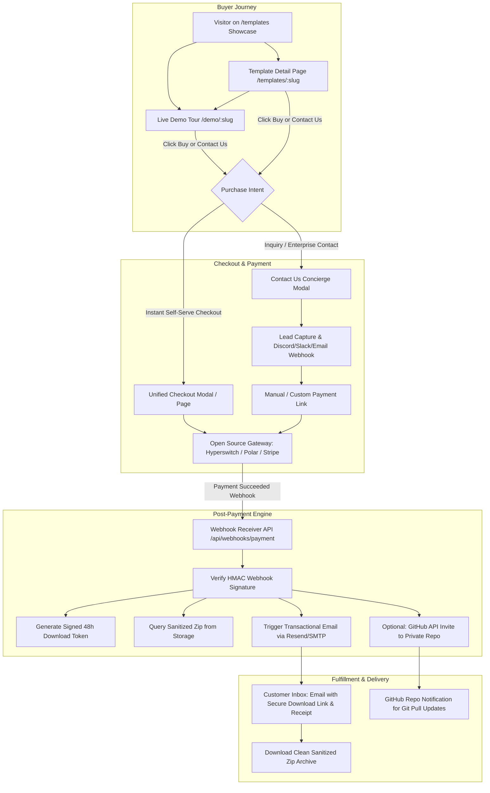
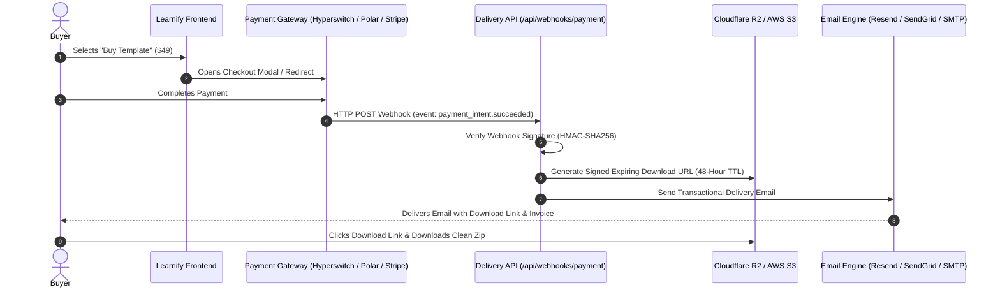
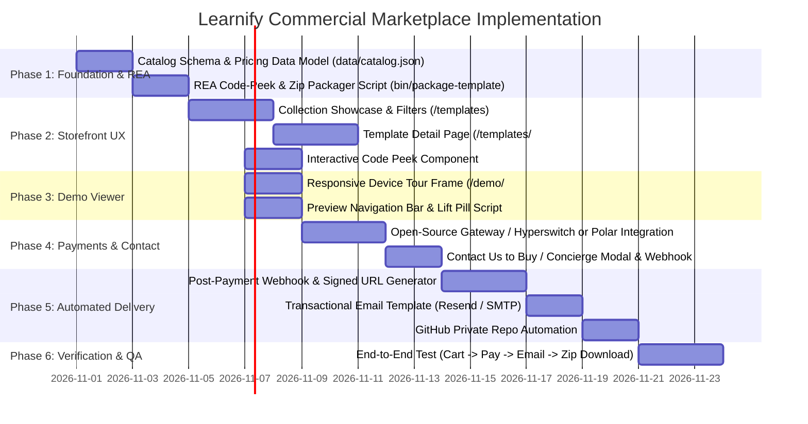

# Learnify Platform — Commercial Template Marketplace Architecture & Implementation Plan 🚀

> **Target:** Transform Learnify Dashboard into a high-converting, commercial digital product marketplace to sell all 26+ production-grade dashboard suites.  
> **Benchmark Reference:** [Code and Chill Templates](https://codeandchill.store/templates), [Product Detail / Fitlo](https://codeandchill.store/templates/fitlo), and [Live Demo Tour](https://demo.codeandchill.store/fitlo/).  
> **Branch:** `feature/template-marketplace-architecture`  
> **Core Tooling:** REA (Reverse Engineering Assistant — `rea.tools`, `@morluto/rea`, and `bin/rea-inspector.mjs`) for asset auditing, AST code-peek generation, and sanitized production zip packaging.

---

## 📑 Table of Contents
1. [Executive Summary & Core Objectives](#1-executive-summary--core-objectives)
2. [End-to-End System Architecture](#2-end-to-end-system-architecture)
3. [Storefront & Buyer UX Specifications](#3-storefront--buyer-ux-specifications)
   - [3.1 Master Catalog & Collection Page (`/templates`)](#31-master-catalog--collection-page-templates)
   - [3.2 Template Detail Page (`/templates/:slug`)](#32-template-detail-page-templatesslug)
   - [3.3 Responsive Live Preview Demo Tour (`/demo/:slug`)](#33-responsive-live-preview-demo-tour-demoslug)
   - [3.4 The Interactive Code Peek ("What is in the zip")](#34-the-interactive-code-peek-what-is-in-the-zip)
4. [Pricing Matrix & Tiering Strategy](#4-pricing-matrix--tiering-strategy)
5. [Payment Gateway Evaluation: Open-Source vs. Hosted](#5-payment-gateway-evaluation-open-source-vs-hosted)
   - [5.1 Comprehensive Gateway Comparison](#51-comprehensive-gateway-comparison)
   - [5.2 Recommended Primary Stack: Hyperswitch + Direct UPI](#52-recommended-primary-stack-hyperswitch--direct-upi)
   - [5.3 Turnkey Alternative: Polar.sh (Open-Source Developer Platform)](#53-turnkey-alternative-polarsh-open-source-developer-platform)
6. [Post-Payment Fulfillment & Automated Code Delivery](#6-post-payment-fulfillment--automated-code-delivery)
   - [6.1 The 4-Stage Instant Delivery Pipeline](#61-the-4-stage-instant-delivery-pipeline)
   - [6.2 The "Contact Us / Concierge" Custom Purchase Flow](#62-the-contact-us--concierge-custom-purchase-flow)
   - [6.3 Cryptographically Signed Download Links](#63-cryptographically-signed-download-links)
   - [6.4 Automated GitHub Private Repo Invitation](#64-automated-github-private-repo-invitation)
7. [REA Tooling & Reverse Engineering Integration](#7-rea-tooling--reverse-engineering-integration)
   - [7.1 Automated Asset & Health Verification](#71-automated-asset--health-verification)
   - [7.2 Automated "What is in the zip" Code Peek Harvester](#72-automated-what-is-in-the-zip-code-peek-harvester)
   - [7.3 Clean-Room Zip Packaging & Sanitization](#73-clean-room-zip-packaging--sanitization)
8. [Phased Implementation Roadmap & Milestones](#8-phased-implementation-roadmap--milestones)

---

## 1. Executive Summary & Core Objectives

Learnify Dashboard currently houses **26 production-grade, pixel-perfect web application suites** (LNF-001 through LNF-026), built with pure HTML5, Vanilla CSS custom properties, and Vanilla ES6 modules (zero external build-step bloat).

The objective of this initiative is to commercialize the platform into a self-service marketplace where developers, founders, agencies, and teams can:
1. **Browse & Filter** the full collection with transparent pricing, category tags, and feature summaries.
2. **Inspect Deep Details**: View domain use cases, live tech stack, version changelogs, customer reviews, and an interactive **"What is in the zip" Code Peek** before purchasing.
3. **Experience Live Responsive Demos**: Test drive full single-page application suites inside an interactive device-frame viewer (Desktop, Tablet, Mobile) with theme switching and a persistent "Buy / Contact" floating pill.
4. **Checkout Seamlessly**: Purchase via open-source self-hosted or modern developer-friendly payment gateways (supporting global cards, PayPal, and India UPI/Netbanking), or opt for a "Contact Us to Buy" concierge flow for custom invoicing.
5. **Receive Automated Code Delivery**: Receive immediate post-payment access via a secure, time-limited download link emailed instantly with receipts and optional GitHub repository access.

---

## 2. End-to-End System Architecture



---

## 3. Storefront & Buyer UX Specifications

### 3.1 Master Catalog & Collection Page (`/templates`)
Modeled after `https://codeandchill.store/templates`:
- **Sticky Filter & Category Bar**:
  - Filter pills: All (26), E-Commerce & Retail, Social & Media, Finance & Banking, Health & Clinic, ERP & Operations, Fitness, Creative & Portfolios.
  - Search Input with `⌘K` keyboard shortcut and instant full-text filtering.
  - Sort by: "Featured", "Price: Low to High", "Price: High to Low", "Most Pages".
- **Product Cards**:
  - High-res cover visual / interactive micro-video preview.
  - Authentic Indian brand name (`Vanijya Retail`, `Samvad Social`, `Kutumb Money`, etc.) + English domain utility (`Omnichannel Sales & POS`).
  - Feature highlights (e.g. `13 SPA Views`, `GSAP Motion`, `Dark/Light Mode`).
  - Tech badges (`HTML5`, `Vanilla CSS`, `ES6 Modules`, `Canvas/SVG Charts`).
  - Distinct Price Badge (`$49` / `₹3,499`).
  - Primary CTA buttons: `Live Preview →` and `Details & Code Peek`.

### 3.2 Template Detail Page (`/templates/:slug`)
Modeled after `https://codeandchill.store/templates/fitlo`:
- **Hero Presentation**:
  - Title, category badge, and authentic bilingual identity.
  - High-level pitch answering three core questions:
    - **Good for**: Target industry, agency, or founder profile.
    - **How it works**: Core workflow, user journey, interactive components.
    - **How to use**: Setup instructions (`npx serve`, standard folder structure, backend integration points).
- **Pricing & Checkout Box**:
  - **Single Site / Personal License**: $29 – $49 (Build 1 production project).
  - **Developer / Unlimited License**: $79 – $99 (Unlimited client projects, full source, lifetime updates).
  - Action buttons:
    - `Buy Now — Instant Download →` (Launches checkout).
    - `Contact Us to Buy / Request Customization` (Opens concierge inquiry modal).
    - `Open Live Preview ↗` (Launches live demo tour).
- **Interactive Code Peek ("What is in the zip")**:
  - File tree view showing exact hierarchy (`css/`, `js/`, `assets/`, `index.html`).
  - Live click-to-preview syntax viewer for core modular files (`tokens.css`, `router.js`, `store.js`).
- **Detailed Feature Matrix & Specifications**:
  - Total views count, animation engine, responsive breakpoints, total uncompressed/gzipped size.
- **Version History & Changelog**:
  - Dated entries detailing releases (e.g., `v1.0.0 — Initial Release`, `v1.1.0 — Added responsive mobile tab bar`).
- **Cross-Sell / Similar Templates Carousel**:
  - 3 recommended complementary templates based on domain (e.g., viewing `Vanijya Retail` suggests `Pangat POS` and `Bahi Khata`).
- **Customer Reviews & FAQ Accordion**:
  - FAQ: Licensing terms, refunds, source code access, customization inquiries.

### 3.3 Responsive Live Preview Demo Tour (`/demo/:slug`)
Modeled after `https://demo.codeandchill.store/fitlo/`:
- **Top Responsive Preview Chrome Bar**:
  - Left: Back to Storefront button (`← Back to Learnify`).
  - Center: Device Viewport Switcher:
    - **Desktop**: 100% full width / 1440px.
    - **Tablet**: 768px centered container with realistic tablet bezel.
    - **Mobile**: 375px centered container with iOS/Android bezel.
  - Right: Theme switcher (Dark / Light) + Template Price + `Buy Template` CTA.
- **Sandboxed Live Iframe**:
  - Loads `./<slug>/index.html` in an isolated viewport.
  - Dispatches `postMessage` to sync theme state between parent toolbar and template iframe.
- **The Floating Purchase Pill (`.cc-preview-pill` / `.learnify-preview-pill`)**:
  - Fixed floating pill positioned at bottom-right of the demo view.
  - Displays: `BUY THIS TEMPLATE — $49 →` (or `CONTACT US →`).
  - Equipped with the auto-lift collision script that detects if bottom navigation tab bars (`.tabbar`, `.mnav`) are present, automatically raising the pill to prevent overlap!

### 3.4 The Interactive Code Peek ("What is in the zip")
To provide high buyer trust (mirroring Code & Chill's file tree):
- Expandable ASCII / SVG tree component:
  ```text
  vanijya/
  ├── index.html                   # Pure semantic HTML5 shell
  ├── css/
  │   ├── reset.css                # Box-sizing & baseline fonts
  │   ├── tokens.css               # Design tokens (colors, radii, shadows)
  │   ├── layout.css               # App shell, sidebar & sticky topbar
  │   ├── components.css           # Buttons, gauges, cards, modals
  │   ├── animations.css           # Keyframes & spring transitions
  │   ├── responsive.css           # Mobile (<768px), Tablet, Desktop
  │   └── pages/                   # 13 Dedicated view stylesheets
  ├── js/
  │   ├── main.js                  # Entry orchestrator
  │   ├── router.js                # Hash-based SPA router
  │   ├── theme.js                 # Zero-flash dark/light theme engine
  │   ├── store.js                 # State & mock order records
  │   └── components/              # Interactive chart controllers
  └── assets/                      # Local SVGs, WebP visuals & icons
  ```

---

## 4. Pricing Matrix & Tiering Strategy

Templates are tiered according to complexity, number of SPA views, and interactive features:

| Tier | Category / Complexity | Included Templates | Price (USD) | Price (INR) | What Buyer Gets |
|---|---|---|---|---|---|
| **Tier 1: Starter** | Micro Landing Pages, Single-Page Portfolios & Interactive Showcases | `aarambh` (Intro), `kaala` (Studio), `mishri` (3D Confectionery), `daksh` (Portfolio) | **$29** | **₹2,399** | Complete source code, single site license, clean assets, 6 months email support |
| **Tier 2: Business** | Focused Business Dashboards & Single-Domain Apps (3–6 Views) | `dantika` (Dental), `karigar` (Support), `bahikhata` (Shop POS), `gati` (Fitness), `aamrai` (Fruit Shop), `sandhi` (Pipeline) | **$49** | **₹3,999** | Complete source code, single site license, modular CSS/JS, 1 year updates |
| **Tier 3: Flagship Suite** | Full-Scale Enterprise SPAs (7–13 Views with Kanban, SVG Gauges, Drag-and-Drop) | `vanijya` (Retail), `samvad` (Social), `kutumb` (Finance), `parivahan` (Logistics), `karkhana` (ERP), `rasayan` (Lab), `pangat` (Restaurant) | **$79** | **₹6,499** | Complete source code, developer unlimited license, all 13 views, editable mock data engine |
| **Tier 4: All-Access Bundle** | Complete Access to All 26+ Suites + Future Releases | **All 26 Suites (LNF-001 to LNF-026)** | **$249** | **₹19,999** | Unlimited commercial client licenses for all templates, instant zip downloads, private GitHub repo access, priority concierge support |

---

## 5. Payment Gateway Evaluation: Open-Source vs. Hosted

The user asked: *"like open source alternative of the razorpay and stripe that we can integrate .. so what u suggest .."*

### 5.1 Comprehensive Gateway Comparison

| Solution | Open Source? | License | Tech Stack | Payment Methods Supported | Self-Hosting & Overhead | Best For |
|---|---|---|---|---|---|---|
| **Hyperswitch** *(by Juspay)* | **Yes (100%)** | Apache 2.0 | Rust | 50+ Gateways (Stripe, Razorpay, PayPal, Adyen, Apple Pay, Google Pay, UPI, Netbanking) | Docker / Kubernetes. Single orchestrator proxying underlying processors with 0% extra gateway fees. | **Top Open-Source Pick:** Unified multi-processor router with zero vendor lock-in. |
| **MedusaJS v2** | **Yes (100%)** | MIT | Node.js / TypeScript | Extensible plugins (Stripe, PayPal, Razorpay, Manual Bank Transfer) | Simple Node.js backend. Full digital product cart, customer accounts, and order management. | **Full Open-Source E-Commerce:** If you want a complete headless commerce platform. |
| **Polar.sh** | **Yes (Open Core)** | Apache 2.0 | Python (FastAPI) + Next.js | Global Cards, Apple Pay, Google Pay, international payments | Cloud hosted (with 5% fee) or self-hostable. Specifically engineered for selling code repos, zip downloads, and developer tools. | **Turnkey Developer Pick:** Handles digital asset distribution, licenses, and tax automatically. |
| **Kill Bill** | **Yes (100%)** | Apache 2.0 | Java | Custom plugins for payment gateways, invoices, subscription logic | Heavier Java stack. Designed for large-scale enterprise billing. | Complex subscription billing (overkill for one-off template zips). |
| **BTCPay Server** | **Yes (100%)** | MIT | C# / .NET | Bitcoin, Lightning Network, Monero, Liquid | Light Docker setup, 0% fees, 100% peer-to-peer crypto payments. | Pure crypto-native buyers worldwide. |
| **Direct UPI Dynamic QR + Webhook** | **Custom OSS** | Open | Node.js / Python | UPI (PhonePe, Google Pay, Paytm, BHIM) | Zero transaction fees (0%), instant settlement directly into your Indian bank account. Uses dynamic UPI intent string + webhook or manual UTR reconciliation. | **Best for Indian Domestic Buyers** (Zero gateway commissions). |

### 5.2 Recommended Primary Stack: Hyperswitch + Direct UPI
1. **Hyperswitch (Self-Hosted via Docker)**:
   - Provides a modern Stripe-like drop-in checkout UI (`HyperLoader.js`).
   - Acts as the single backend interface. You can connect Stripe (for international cards) and Razorpay or Cashfree (for domestic INR cards and UPI) behind Hyperswitch.
   - If one payment processor faces downtime, Hyperswitch automatically fails over to another without losing the customer!
2. **Direct UPI Flow (Zero Transaction Fee Mode for India)**:
   - For Indian customers, provide a dynamic UPI QR Code generator (`upi://pay?pa=yourvpa@upi&pn=Learnify&am=3999&tr=ORDER123&cu=INR`).
   - Customer scans & pays, enters the 12-digit UTR transaction number, and the system verifies and delivers the code instantly.

### 5.3 Turnkey Alternative: Polar.sh (Open-Source Developer Platform)
If you prefer not to manage Docker infrastructure on day one:
- **Polar.sh** is purpose-built for selling developer templates and GitHub source code.
- Has built-in support for:
  - File upload / zip asset delivery upon payment.
  - GitHub Organization private repository invite upon payment.
  - Embedded checkout overlay with one line of code.

---

## 6. Post-Payment Fulfillment & Automated Code Delivery

### 6.1 The 4-Stage Instant Delivery Pipeline



### 6.2 The "Contact Us / Concierge" Custom Purchase Flow
For clients who want custom modifications, invoices for corporate accounting, or alternate payment methods (wire transfer, USDT, PO):
1. **Trigger**: Buyer clicks `Contact Us to Buy` on the template card or detail page.
2. **Modal Form**: Captures:
   - Full Name & Business Email.
   - Selected Template(s) (pre-selected from the page).
   - Expected use case (Personal, Client agency, Enterprise).
   - Needs customization? (Yes/No with description).
3. **Dispatch**: Form sends instant webhook to:
   - Platform admin email.
   - Team Slack/Discord channel (`#inquiries-learnify`).
   - Auto-acknowledgement email sent to buyer with a reference ticket ID.
4. **Fulfillment**: Admin sends a customized payment link; once paid, the automated delivery pipeline dispatches the zip.

### 6.3 Cryptographically Signed Download Links
To prevent unauthorized sharing of download URLs:
- URLs are generated with HMAC-SHA256 tokens:
  ```text
  https://learnify.store/api/download?template=vanijya&token=<hmac_signature>&expires=1730467200
  ```
- **Validation Rules**:
  - `expires` timestamp must be within 48 hours.
  - Secret signing key never leaves the server.
  - Maximum 5 download attempts per token.

### 6.4 Automated GitHub Private Repo Invitation
For premium buyers:
- The checkout flow asks: *"GitHub Username for source updates (optional)"*.
- Upon payment, a webhook triggers a GitHub API call:
  ```bash
  PUT https://api.github.com/repos/Learnify-Platform/suite-vanijya/collaborators/:username
  ```
- The buyer receives a GitHub collaboration invite and can `git clone` and `git pull` future updates directly!

---

## 7. REA Tooling & Reverse Engineering Integration

Learnify's secret weapon for template quality is the **REA (Reverse Engineering Assistant)** toolchain ([rea.tools](https://rea.tools/) and [github.com/morluto/rea](https://github.com/morluto/rea)).

### 7.1 Automated Asset & Health Verification
Before any template is packaged and sold, REA verification is run via `node bin/rea-inspector.mjs <slug>`:
1. **AST & Asset Completeness**: Validates all referenced WebP images, SVGs, custom fonts, and module scripts exist locally in `./assets/` with **0 missing 404s**.
2. **Token Integrity**: Checks that CSS custom properties (`--bg`, `--accent`, `--card-bg`) are declared and resolve without flash.
3. **Relative Path Safety**: Ensures no hardcoded absolute paths (`/assets/`) exist; all paths must be relative (`./assets/`) so the template runs in any subfolder or local origin.

### 7.2 Automated "What is in the zip" Code Peek Harvester
We will build `bin/generate-code-peek.mjs` using REA AST traversal:
- Scans the template directory.
- Filters out non-essential build files.
- Generates a lightweight JSON manifest of the directory tree:
  ```json
  {
    "slug": "vanijya",
    "totalFiles": 28,
    "totalSize": "1.4 MB",
    "tree": [
      { "path": "index.html", "type": "file", "lines": 420 },
      { "path": "css/tokens.css", "type": "file", "lines": 115 },
      { "path": "css/layout.css", "type": "file", "lines": 280 },
      { "path": "js/main.js", "type": "file", "lines": 95 }
    ]
  }
  ```
- Injects this tree directly into the template detail page so customers can peek inside the zip file before buying!

### 7.3 Clean-Room Zip Packaging & Sanitization
A customer should never download internal development artifacts or preview tracking pills.  
We will create `bin/package-template.mjs`:
- Clones template files into a clean build sandbox.
- Strips out `.cc-preview-pill` / `.learnify-preview-pill` floating buttons.
- Strips out any internal analytics or file-protocol banners.
- Injects a standard commercial `LICENSE.md` and `README.md` with setup instructions.
- Creates an encrypted, optimized `.zip` archive ready for secure distribution.

---

## 8. Phased Implementation Roadmap & Milestones



### Next Immediate Action Items:
1. **Catalog Registry**: Create `data/catalog.json` establishing official pricing, descriptions, tech stacks, and features for all 26 suites.
2. **REA Packager**: Build `bin/package-template.mjs` and `bin/generate-code-peek.mjs`.
3. **Template Detail Page & Demo Viewer**: Scaffold the modular detail page and device-responsive demo viewer shell.
4. **Checkout Integration**: Implement the Hyperswitch / Polar drop-in checkout and Contact Us concierge workflow.
